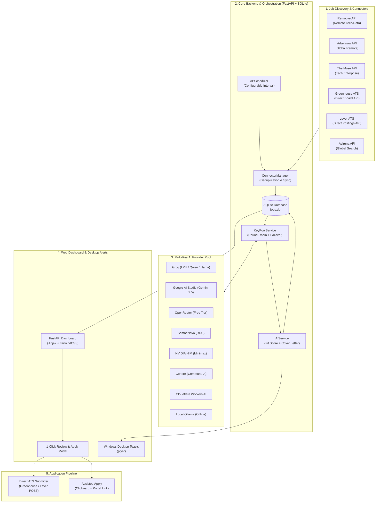

# JobPulse AI — Complete System Architecture & AI Handoff Document

> **Target Audience**: AI Coding Assistants, LLMs, and Software Engineers continuing development or maintenance on this codebase.  
> **Repository Location**: `d:\DS Projects\Job Finding project`  
> **Stack**: Python 3.12+, FastAPI, SQLite, SQLAlchemy, Uvicorn, Jinja2, TailwindCSS, httpx, pypdf, APScheduler, Plyer.

---

## 1. Executive Summary & Core Purpose

**JobPulse AI** is a local-first, automated job search and semi-autonomous application assistant designed to solve "job application fatigue". Instead of requiring manual searches across dozens of job boards and manual tailoring of resumes/cover letters, the platform:

1. **Continuously Discovers Opportunities**: Connects to public job APIs and public ATS board feeds (Greenhouse, Lever, Remotive, Arbeitnow, The Muse, Adzuna) without needing paid enterprise API access.
2. **AI Fit Scoring (0–100%)**: Evaluates job descriptions against the candidate's master PDF resume and profile using LLMs.
3. **Multi-Key AI Pool & Self-Healing**: Pools multiple free and paid API keys across **Groq, OpenRouter, Google Gemini, SambaNova, NVIDIA NIM, Cohere, Cloudflare, or local Ollama**. It performs **round-robin load balancing**, handles rate limits (HTTP 429) via **auto-cooldown**, and automatically **heals deprecated models (HTTP 404/410) on the fly** by querying the provider's `/v1/models` endpoint.
4. **Semi-Autonomous 1-Click Application Pipeline**: For ATS platforms supporting public candidate submissions (Greenhouse, Lever), it submits the application payload (resume PDF, tailored cover letter, screening answers) directly via API with 1-click candidate approval. For other portals, it copies the tailored cover letter to the clipboard and opens the direct application link.
5. **Background Scheduling & Desktop Toasts**: Periodically syncs jobs in the background and sends native Windows desktop toast notifications when high-match opportunities ($\ge 80\%$) appear.

---

## 2. System Architecture



---

## 3. Directory Structure & Key Files

```
d:\DS Projects\Job Finding project\
├── app\
│   ├── __init__.py
│   ├── main.py                     # FastAPI application routes, lifespan, and UI endpoints
│   ├── config.py                   # Pydantic Settings reading .env and default constants
│   ├── database.py                 # SQLAlchemy engine, SessionLocal, Base model
│   ├── models.py                   # SQLAlchemy schema: Job, CandidateProfile, ApplicationPackage, AIKey, ConnectorSetting
│   ├── connectors\
│   │   ├── __init__.py
│   │   ├── base.py                 # Abstract BaseConnector interface
│   │   ├── remotive.py             # Remotive open remote jobs connector
│   │   ├── arbeitnow.py            # Arbeitnow European/Global tech jobs connector
│   │   ├── themuse.py              # The Muse company & job connector
│   │   ├── greenhouse.py           # Greenhouse ATS board scraper & direct candidate applicant API POST
│   │   ├── lever.py                # Lever ATS postings scraper & direct candidate applicant API POST
│   │   ├── adzuna.py               # Adzuna global search connector (salary insights)
│   │   └── manager.py              # ConnectorManager: orchestrates, deduplicates, and scores new jobs
│   ├── services\
│   │   ├── __init__.py
│   │   ├── ai_service.py           # Ingests prompts for scoring, cover letters, and screening questions
│   │   ├── key_pool_service.py     # Round-robin router, auto-cooldown (HTTP 429), and dynamic model self-healing (HTTP 404/410)
│   │   ├── resume_service.py       # pypdf PDF parser for extracting candidate text from uploaded resume
│   │   ├── scheduler.py            # AsyncIOScheduler for periodic background synchronization
│   │   └── notifier.py             # plyer-based native Windows desktop toast notifications
│   └── templates\
│       ├── base.html               # Main layout, nav, toast notification containers
│       ├── dashboard.html          # Job stream, filter pills, score badges, 1-click apply modal
│       ├── profile.html            # Profile editor, master PDF resume uploader, extracted text viewer
│       └── settings.html           # Multi-Key AI Pool table, key tester, scheduler, and connector toggles
├── data\
│   ├── jobs.db                     # SQLite database (auto-generated)
│   └── resumes\                    # Stored master candidate resume PDFs
├── .env.example                    # Environment variable template
├── .env                            # Active environment configuration
├── .gitignore                      # Git ignore file
├── requirements.txt                # Python dependencies
├── run.py                          # Application entry point (python run.py)
└── PROJECT_OVERVIEW.md             # This document
```

---

## 4. Key Subsystems & Design Details

### 4.1 Multi-Key AI Pool (`app/services/key_pool_service.py`)
- **Database Backed**: Keys are stored in the `ai_keys` table rather than just `.env`, allowing multiple keys per provider.
- **Round-Robin Load Balancing**: Evenly distributes LLM calls across all healthy keys so free tier rate limits (RPM/TPM) are rarely hit.
- **Smart Rate-Limit Auto-Cooldown**:
  - Catches HTTP `429 (Too Many Requests)` or HTTP `403 (Quota Exceeded)`.
  - Parses `Retry-After` header or defaults to a 15–30 minute cooldown.
  - Sets `is_in_cooldown = True` and `cooldown_until = timestamp`.
  - **Instantly retries the prompt on the next healthy key in the pool without failing the application workflow.**
  - Auto-clears cooldown once `cooldown_until <= datetime.utcnow()`.
- **Dynamic Model Auto-Discovery & Self-Healing**:
  - Catches HTTP `404` or `410` ("Model Deprecated", "Model Not Found", "Gone").
  - Queries `{base_url}/models` dynamically with the key.
  - Filters out audio/vision/guard models and picks the top active chat/instruct model (e.g. `qwen/qwen3.8-27b` on Groq, `minimaxai/minimax-m3.1-flash` on NVIDIA).
  - Updates `key.model` in SQLite and immediately retries the chat completion successfully.
- **Heuristic Fallback Engine**: If all keys in the pool are exhausted or disabled, the system falls back to rule-based keyword & TF scoring, guaranteeing 0% downtime.

### 4.2 Public Connector & Submission Engine (`app/connectors/`)
- **Remotive & Arbeitnow & The Muse**: Open JSON feeds that require zero authentication.
- **Greenhouse ATS**:
  - Discovery: `https://boards-api.greenhouse.io/v1/boards/{board}/jobs?content=true`
  - Direct Application POST: `https://boards-api.greenhouse.io/v1/boards/{board}/jobs/{job_id}` (multipart form: `first_name`, `last_name`, `email`, `resume` file, `cover_letter_text`).
- **Lever ATS**:
  - Discovery: `https://api.lever.co/v0/postings/{company}?mode=json`
  - Direct Application POST: `https://api.lever.co/v0/postings/{company}/{posting_id}` (multipart: `name`, `email`, `phone`, `comments`, `resume` file).
- **Adzuna**:
  - Optional global job search with salary insights (requires free `ADZUNA_APP_ID` & `ADZUNA_APP_KEY`).

### 4.3 Database Models (`app/models.py`)
- `Job`: `external_id`, `platform`, `title`, `company`, `location`, `job_type`, `salary_range`, `url`, `description`, `match_score` (0-100), `match_reason`, `matching_skills` (JSON), `missing_keywords` (JSON), `status` (`discovered`, `review_pending`, `applied`, `interviewing`, `skipped`, `archived`).
- `CandidateProfile`: Contact info, `target_titles`, `skills`, `years_of_experience`, `work_authorization`, `notice_period`, `expected_salary`, `summary`, `master_resume_filename`, `master_resume_text`.
- `ApplicationPackage`: Linked 1-to-1 with `Job`, holds `tailored_cover_letter`, `screening_answers` (JSON), `resume_path`, `submission_method` (`api` vs `direct_link`), `submission_status` (`draft`, `submitted`, `external_opened`).
- `AIKey`: Multi-key pool tracking `label`, `provider`, `api_key`, `model`, `base_url`, `enabled`, `is_in_cooldown`, `cooldown_until`, `total_requests`, `successful_requests`, `rate_limit_hits`.
- `ConnectorSetting`: Toggles and sync logs for individual connectors.

---

## 5. API Routes Reference (`app/main.py`)

### Web Pages
- `GET /`: Redirects to `/dashboard`.
- `GET /dashboard`: Main feed with status tabs (`review_pending`, `applied`, `interviewing`), keyword search, match score filter.
- `GET /profile`: Profile management and PDF resume upload.
- `POST /profile`: Saves candidate data, parses uploaded PDF with `pypdf`, and stores extracted text.
- `GET /settings`: Multi-Key AI Pool table, connector toggles, scheduler settings.
- `POST /settings`: Updates runtime and `.env` configs.

### REST Endpoints
- `POST /api/sync`: Triggers immediate parallel sync across all enabled job connectors.
- `GET /api/job/{job_id}/review`: Retrieves pre-drafted application package (tailored letter + candidate data).
- `POST /api/job/{job_id}/apply`: 1-Click confirm. Submits directly via ATS API or prepares assisted clipboard apply.
- `POST /api/job/{job_id}/status`: Updates job status (`applied`, `interviewing`, `skipped`, `archived`).
- `POST /api/job/{job_id}/regenerate-cover-letter`: Re-prompts the AI pool to write a new tailored letter.
- `POST /api/keys`: Adds a new key to the pool.
- `DELETE /api/keys/{key_id}`: Removes a key from the pool.
- `POST /api/keys/{key_id}/toggle`: Enables or disables a key.
- `POST /api/keys/{key_id}/reset-cooldown`: Clears rate limit cooldown early.
- `POST /api/keys/{key_id}/test`: Pings provider and returns real-time latency in milliseconds.

---

## 6. How to Run the Application

```powershell
# Navigate to project directory
cd "d:\DS Projects\Job Finding project"

# Run directly via virtual environment (no activation needed)
.\.venv\Scripts\python.exe run.py
```

Or with virtual environment activation:
```powershell
.\.venv\Scripts\Activate.ps1
python run.py
```

Open in browser: **`http://localhost:8000`**

---

## 7. Instructions for Incoming AI Agents

When modifying or extending this codebase, adhere to the following principles:

1. **Preserve Free & Open-Weight Accessibility**:
   - Keep the OpenAI-compatible standard in `key_pool_service.py`. Any new provider that supports `/chat/completions` can be added as a dictionary preset in `PROVIDER_PRESETS`.
2. **Never Break the Fallback Hierarchy**:
   - If a provider model fails or hits 404, let `_auto_discover_new_model` attempt self-healing.
   - If rate-limited (429), ensure `RateLimitException` is raised so the pool automatically fails over to the next key.
   - If all keys fail, allow `ai_service.py` to drop into `_heuristic_match()`.
3. **Database Concurrency**:
   - SQLite is used with `check_same_thread=False`. Keep transactions scoped using `SessionLocal` or FastAPI's `Depends(get_db)`.
4. **ATS Application Safety**:
   - Keep the human-in-the-loop review modal (`review_pending` status) as the default flow before final application submission. Do not submit blindly without user confirmation unless explicitly requested.

